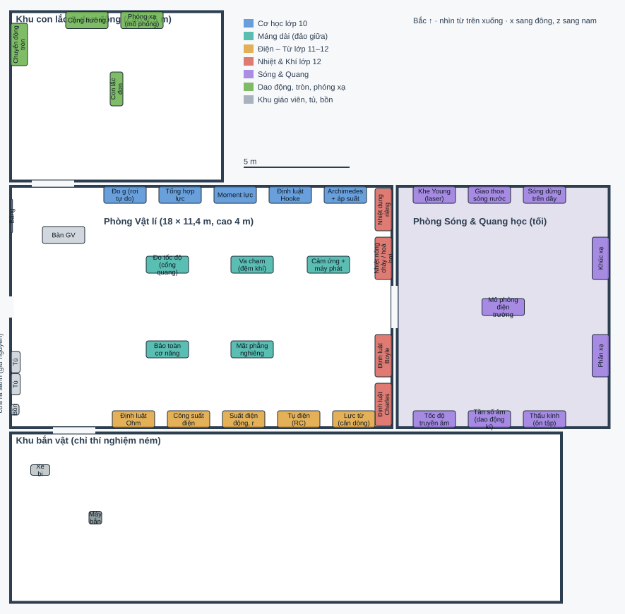

# Phase T-1 plan — the Physics wing (2026-11-05)

Status: **APPROVED** (P1–P3 (a), 2026-11-05). Contract: `docs/phase-t-curriculum-contract.md`
(approved, all (a)). T-1a is built: the drawing shows the wing as built; the table below is the
plan as approved, and where the build departs from it is listed in `docs/phase-t-report.md` §1.

## 1. The plan

`docs/plans/physics-wing.svg`: top view, north up, x east, z south, 1 m = 30 px; drawn from the
table of §2 (one source for both). One scene (`physics-lab`), four rooms:

- **Physics Lab** (`physics-lab`, x −5…13, z −5.7…5.7, 3.5 m high; was 14 m long, now 18): the hub
  door kept where it is (west wall, z 0). West: the teacher's zone (demonstration bench facing east,
  whiteboard, two instrument cabinets, a sink bench with first aid and the lab rules) and the doors
  to the bay (north) and the range (south). North wall: grade 10 mechanics. South wall: grade 11–12
  electricity and magnetism. East wall: grade 12 thermal physics and gases, either side of the door
  to the optics room. Middle: two islands for the long tracks, a 3.2 m aisle between them from the
  hub door to the optics door, a free floor kept for later steps.
- **Waves & Optics** (`waves-optics`, new, x 13.25…23.25, z −5.7…5.7, 3.5 m): dark — its ceiling
  lights on a switch, each bench with its own lamp (interference, the laser and ray optics need the
  dark). Waves on the north wall, sound and the lens on the south, ray optics on the east, the
  electric-field simulation table in the middle.
- **Pendulum & Oscillation bay** (`pendulum-bay`, as today, 4.5 m high): the long pendulum,
  resonance, circular motion behind a guard rail, the radioactivity simulation table.
- **Projectile range** (`projectile-range`, as today): the launcher and its ball cart only.

Rules: benches 2.0 × 0.8 m (top 0.9 m), aisles ≥ 1.2 m everywhere (north benches to island 2.5 m,
islands to south benches 2.0 m), a stand point in front of every bench (checked by the zone tests),
every experiment on its own bench except two pairs that share a kit (Ohm + power: one supply;
buoyancy + liquid pressure: one tank).

## 2. Every bench and piece of furniture

| Room             | Centre x, z (m) | Size x × z (m) | Station / furniture              | Experiment(s)              | Step      |
| ---------------- | --------------- | -------------- | -------------------------------- | -------------------------- | --------- |
| physics-lab      | -3.6, -3.2      | 0.8 × 2        | teacher demo bench, faces east   | —                          | —         |
| physics-lab      | -4.95, -3.2     | 0.08 × 1.6     | whiteboard (west wall)           | —                          | —         |
| physics-lab      | -4.7, 2         | 0.6 × 1.2      | instrument cabinet               | —                          | —         |
| physics-lab      | -4.7, 3.3       | 0.6 × 1.2      | instrument cabinet               | —                          | —         |
| physics-lab      | -4.2, 5.3       | 1.6 × 0.8      | sink bench, first aid, lab rules | —                          | —         |
| physics-lab      | 0.4, -5.3       | 2 × 0.8        | Đo g (rơi tự do)                 | free-fall                  | T-1 / T-2 |
| physics-lab      | 3, -5.3         | 2 × 0.8        | Tổng hợp lực                     | force-composition          | T-2       |
| physics-lab      | 5.6, -5.3       | 2 × 0.8        | Moment lực                       | moment                     | T-2       |
| physics-lab      | 8.2, -5.3       | 2 × 0.8        | Định luật Hooke                  | hookes-law                 | T-1       |
| physics-lab      | 10.8, -5.3      | 2 × 0.8        | Archimedes + áp suất             | buoyancy, liquid-pressure  | T-1 / T-2 |
| physics-lab      | 2.4, -2         | 2 × 0.8        | Đo tốc độ (cổng quang)           | speed                      | T-2       |
| physics-lab      | 6.4, -2         | 2 × 0.8        | Va chạm (đệm khí)                | collisions                 | T-1       |
| physics-lab      | 2.4, 2          | 2 × 0.8        | Bảo toàn cơ năng                 | mechanical-energy          | T-1       |
| physics-lab      | 6.4, 2          | 2 × 0.8        | Mặt phẳng nghiêng                | inclined-plane             | T-1       |
| physics-lab      | 10, 0           | 1.6 × 2.4      | free floor kept for later steps  | —                          | —         |
| physics-lab      | 12.6, -4.6      | 0.8 × 2        | Nhiệt dung riêng                 | specific-heat              | T-4       |
| physics-lab      | 12.6, -2.3      | 0.8 × 2        | Nhiệt nóng chảy / hoá hơi        | latent-heat                | T-4       |
| physics-lab      | 12.6, 2.3       | 0.8 × 2        | Định luật Boyle                  | boyle                      | T-4       |
| physics-lab      | 12.6, 4.6       | 0.8 × 2        | Định luật Charles                | charles                    | T-4       |
| physics-lab      | 0.8, 5.3        | 2 × 0.8        | Ohm + công suất                  | ohms-law, electrical-power | T-1       |
| physics-lab      | 3.4, 5.3        | 2 × 0.8        | Suất điện động, r                | emf                        | T-3       |
| physics-lab      | 6, 5.3          | 2 × 0.8        | Tụ điện (RC)                     | capacitor                  | T-3       |
| physics-lab      | 8.6, 5.3        | 2 × 0.8        | Lực từ (cân dòng)                | magnetic-force             | T-4       |
| physics-lab      | 11.2, 5.3       | 2 × 0.8        | Cảm ứng + máy phát               | induction, generator       | T-4       |
| waves-optics     | 15, -5.3        | 2 × 0.8        | Khe Young (laser)                | young                      | T-3       |
| waves-optics     | 17.6, -5.3      | 2 × 0.8        | Giao thoa sóng nước              | ripple-tank                | T-3       |
| waves-optics     | 20.2, -5.3      | 2 × 0.8        | Sóng dừng trên dây               | standing-wave              | T-3       |
| waves-optics     | 15, 5.3         | 2 × 0.8        | Tốc độ truyền âm                 | speed-of-sound             | T-3       |
| waves-optics     | 17.6, 5.3       | 2 × 0.8        | Tần số âm (dao động kí)          | sound-frequency            | T-3       |
| waves-optics     | 20.2, 5.3       | 2 × 0.8        | Thấu kính (ôn tập)               | converging-lens            | T-1       |
| waves-optics     | 22.85, -2.3     | 0.8 × 2        | Khúc xạ                          | refraction                 | T-1       |
| waves-optics     | 22.85, 2.3      | 0.8 × 2        | Phản xạ                          | reflection                 | T-1       |
| waves-optics     | 18.25, 0        | 1.6 × 1        | a screen table (simulation)      | electric-field             | T-3       |
| pendulum-bay     | 0, -10.3        | 0.6 × 1.6      | Con lắc đơn                      | pendulum                   | T-1       |
| pendulum-bay     | -3, -12.4       | 2.4 × 0.8      | Cộng hưởng                       | resonance                  | T-3       |
| pendulum-bay     | 3, -8.2         | 1.4 × 1.4      | Chuyển động tròn (rào chắn)      | circular-motion            | T-1       |
| pendulum-bay     | 3.2, -12.4      | 1.6 × 0.8      | a screen table                   | radioactivity              | T-4       |
| projectile-range | -1, 9.95        | 0.6 × 0.6      | Máy bắn                          | projectile-motion          | T-1       |
| projectile-range | -3.6, 7.7       | 0.9 × 0.5      | ball cart                        | —                          | —         |

Step: T-1 is built now; the T-2 … T-4 benches are drawn and labelled "Planned", disabled, until
their step.

## 3. The 14 existing experiments, by hand (T-1b)

The remote desks (four dials, RUN / STOP / RESET, the wall monitor) go. Each parameter becomes what
a student does with the apparatus; each resolution becomes the instrument's own range switch or the
choice of instrument. The results and graphs stay in the 2D results panel, opened from a laptop on
the bench (as the wall monitor opens it today). Models, inputs and results do not change.

| Experiment        | How each setting is made by hand                                                                                                                                                                                               | Run / stop / reset                                                                    |
| ----------------- | ------------------------------------------------------------------------------------------------------------------------------------------------------------------------------------------------------------------------------ | ------------------------------------------------------------------------------------- |
| free-fall         | height: the photogate slid along the stand's scale; resolution: the digital timer's range switch                                                                                                                               | the electromagnet's switch lets the cylinder go; hung back on the magnet; timer RESET |
| hookes-law        | mass: slotted masses hung on the hanger; stiffness: a spring from the box (labelled); resolution: the ruler (mm or cm); offset: the ruler slid to zero; damping: none, a card vane or a cup of water (AFFORDANCE: three steps) | let go of the hanger; caught; masses taken off                                        |
| projectile-motion | speed: the launcher's spring setting; angle: its protractor quadrant, turned by hand; resolution: the tape measure                                                                                                             | the trigger cord; the ball fetched from the cart                                      |
| inclined-plane    | angle: the ramp's support moved along its angle scale; surface: a strip laid on the ramp; mass: masses on the block; length: the end stop placed                                                                               | let go of the block; put back at the top                                              |
| mechanical-energy | release height: the cart held at a mark; mass: masses on the cart; sail: a card clipped on; resolution: the timer's switch                                                                                                     | let go; caught; put back                                                              |
| collisions        | mass: masses on glider A; speed: the spring launcher's notch; restitution: the bumper fitted (velcro, rubber, magnets: AFFORDANCE, three steps of e); resolution: the timer's switch                                           | the launcher's release; gliders put back                                              |
| circular-motion   | length: the marker clip on the string; hanging mass: masses on the hook; bung: one from the tray; resolution: the stopwatch chosen                                                                                             | hold E to whirl (AFFORDANCE: the model's steady rate); let go                         |
| buoyancy          | object: a cube from the set (material, size); liquid: the beaker chosen; resolution: the force sensor's range                                                                                                                  | the cube lowered on the stand's screw; raised                                         |
| pendulum          | length: the clamp loosened, the string set on the scale; angle: the bob drawn aside to the protractor's mark; resolution: the timer's switch                                                                                   | let go of the bob; stopped by hand                                                    |
| ohms-law          | voltage: the supply's knob; resistors: plugged from the box; series / parallel: the links plugged                                                                                                                              | the supply's switch                                                                   |
| electrical-power  | voltage: the supply's knob; lamps: one, two in series, two in parallel, plugged; resolution: the ammeter's range                                                                                                               | the supply's switch                                                                   |
| refraction        | material: a block from the tray (preset indices); direction: the block turned; angle: the ray box moved round the protractor disc; resolution: the protractor                                                                  | the ray box's switch                                                                  |
| reflection        | ray angle: the ray box turned; mirror turn: the mirror turned on its pivot; resolution: the protractor                                                                                                                         | the ray box's switch                                                                  |
| converging-lens   | focal length: a lens from the box (labelled f); object distance: the lens slid on the rail; resolution: the rail's scale                                                                                                       | the lamp's switch; the screen slid to the sharp image                                 |

A material, a lens, a spring, a cube or a
bumper is chosen from a set whose values are the model's own presets or steps of its range — never
a value the model does not offer.

## 4. Delivery

- **T-1a**: the four rooms rebuilt (walls, doors, lights, furniture, benches labelled by their
  experiment), the stations moved to their benches with today's controls brought along beside them;
  the T-2 … T-4 benches labelled "Planned"; save migration (SAVE_VERSION and its test). Phú's display
  QA of the layout.
- **T-1b**: station by station, the controls replaced by the instruments of §3; their tasks and e2e
  rewritten. Phú's QA, full e2e, commit.

## 5. Risks

- T-1b changes how 14 experiments are worked: their e2e specs are rewritten one by one (one e2e at a
  time); the station rule authority (StationSystem) gains the hand actions as guards; the models are
  untouched.
- Moving stations changes their entity ids (the room id): saves migrate (D6); the run history kept
  under the old ids is relabelled by a map.
- The dark optics room must stay readable on Low (bench lamps cast no shadows on Low).

## 6. Decisions for Phú

- **P1 — settings a real lab cannot make** (g on the Moon, Mars, Jupiter for free fall, the pendulum
  and the projectile). (a) **Recommended:** kept, in a small 2D "simulation settings" panel opened
  from the bench's laptop, marked as a simulation (Earth by default). (b) Removed: Earth only, as in a
  real lab.
- **P2 — delivery.** (a) **Recommended:** T-1a (rooms, stations moved with their present controls) for
  an early look at the layout, then T-1b (by hand). (b) All of T-1 at once.
- **P3 — the plan.** (a) **Recommended:** as drawn. (b) Phú's changes (which bench where).
